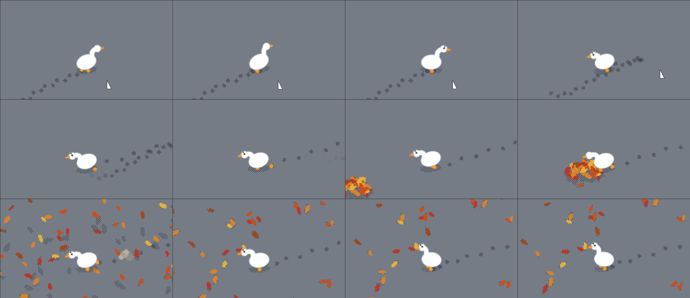
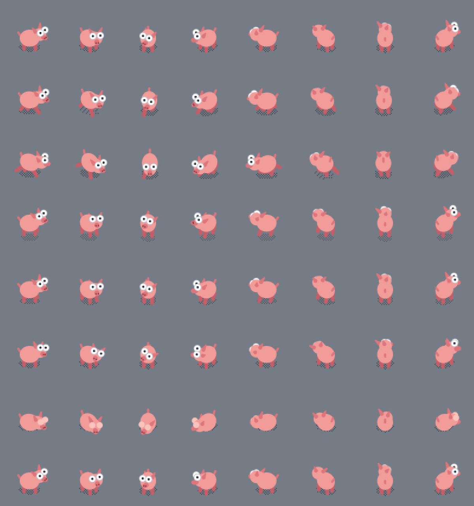
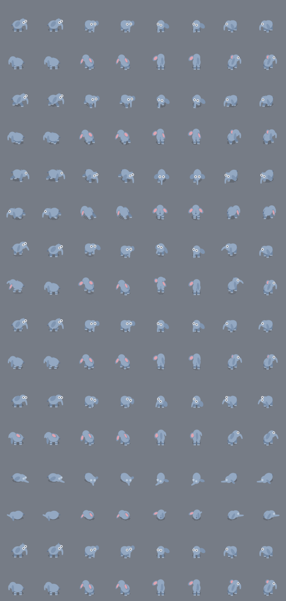
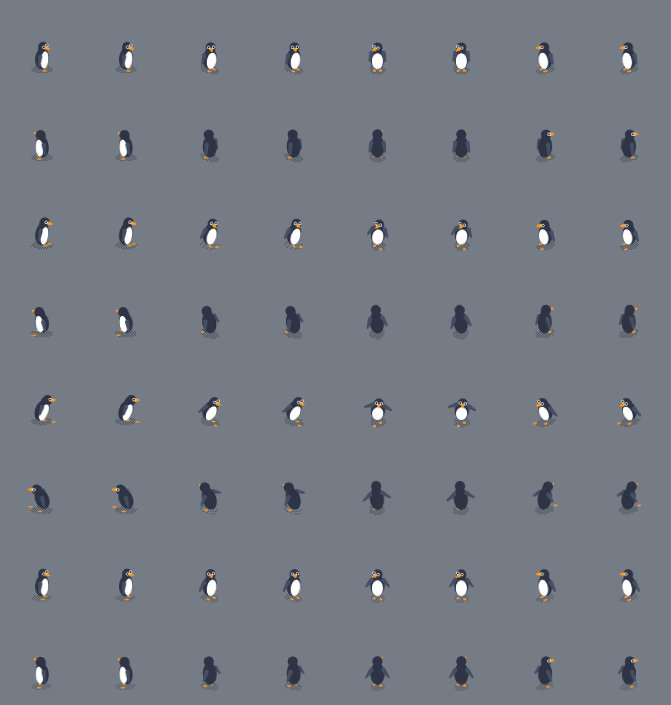
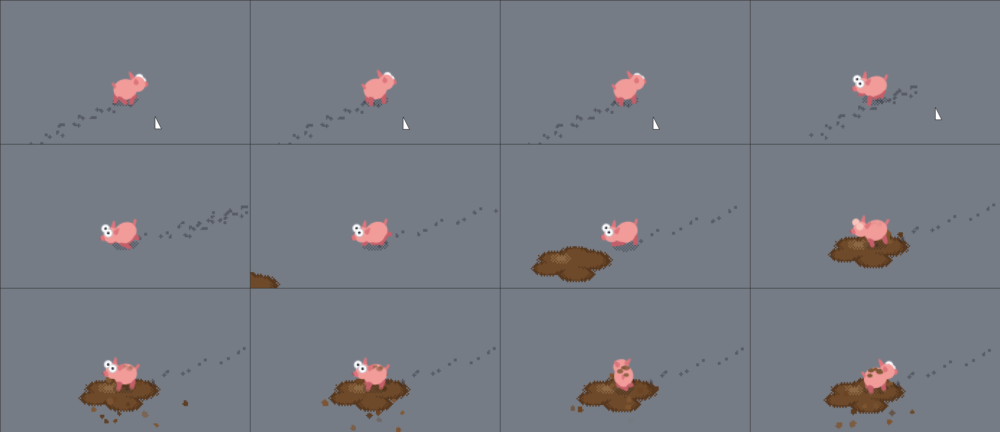

<div align="center">

**Живой персонаж рабочего стола Windows для ваших Rust-приложений**

Свинка, гусь, слоник, енот или пингвин гуляют поверх окон, замечают курсор, приносят карточки уведомлений
и показывают, чем занято приложение: думают, заняты, радуются успеху, расстраиваются из-за ошибки.




</div>

---

## Персонажи

Все виды делят одни решатели и один рендер. Различаются сложение, файл вида `rig.json` и свой каталог сценок.
Ниже — полные листы каждого вида: ходьба и бег по кадрам, затем все жесты в восьми направлениях.

<table>
<tr>
<th>Свинка</th>
<th>Гусь</th>
<th>Слоник</th>
</tr>
<tr>
<td></td>
<td></td>
<td></td>
</tr>
<tr>
<th>Енот</th>
<th>Пингвин</th>
</tr>
<tr>
<td></td>
<td></td>
</tr>
</table>

| Строка | Жест        | Когда играет                           |
| :----: | ----------- | -------------------------------------- |
|   1    | `idle`      | стоит и оглядывается                   |
|   2    | `walk`      | гуляет по экрану                       |
|   3    | `run`       | бежит к цели или от курсора            |
|   4    | `react`     | на щелчок и неожиданности              |
|   5    | `celebrate` | приложение сообщило об успехе          |
|   6    | `think`     | приложение думает (`Status::Thinking`) |
|   7    | `sleep`     | режим `Sleep` или долгий простой       |
|   8    | `wave`      | приветствие                            |

## Сценки

Кроме жестов, у персонажа есть **65 сценок**: короткие истории с предметами, частицами и следами.
22 из них общие, у гуся 15 своих, у свинки 16, у слоника, енота и пингвина по 4.



<details>
<summary><b>Полный список сценок</b></summary>

| Кто    | Сценки                                                                                                                                                                                                                 |
| ------ | ---------------------------------------------------------------------------------------------------------------------------------------------------------------------------------------------------------------------- |
| Все    | `cursor_heist` `zoomies` `note` `chase` `boop` `startle` `sneeze` `hiccups` `dance` `stretch` `stare` `nap` `gift` `ball` `slip` `trip_over_card` `self_scare` `peek` `edge_tumble` `butterfly` `flatten` `fake_death` |
| Гусь   | `leaf_pile` `wall_slam` `honk` `hiss` `march` `skid` `flight` `preen` `crumbs` `bath` `nest` `egg_surprise` `scribble` `neck_tangle` `goslings`                                                                        |
| Свинка | `mud_bath` `oops` `fart_jump` `faceplant` `slide` `stuck` `shake_off` `mud_nap` `puddle_hop` `dig` `sniff` `snack` `bulldozer` `tail_chase` `piggy_bank` `belly_up`                                                    |
| Слоник | `trumpet` `shower` `mouse_scare` `trunk_nap`                                                                                                                                                                           |
| Енот   | `rinse` `rummage` `stash` `lookout`                                                                                                                                                                                    |
| Пингвин | `toboggan` `wipeout` `applause` `strut`                                                                                                                                                                               |

</details>

## Возможности

- **Свои layered-окна поверх рабочего стола.** Персонаж не мешает работать: щелчки мимо
  него проходят насквозь, при полноэкранных приложениях и презентациях он прячется.
- **Самостоятельное поведение.** Планировщик намерений сам решает, гулять, отдыхать,
  подойти к курсору или затеять сценку.
- **Отражает состояние приложения.** `Thinking` и `Busy` держатся, пока их не сменят,
  а `Success`, `Warning` и `Error` отыгрываются один раз.
- **Карточки уведомлений.** Персонаж приносит сообщение на экран и кладёт рядом.
- **Живой отклик.** Персонажа можно щёлкнуть, перетащить или вызвать меню правой кнопкой
  (пауза, скрыть, выход).
- **Свой поток.** Команды не блокируют и не ждут ответа, события читаются опросом.
- **DPI и несколько мониторов.** Масштаб берётся у монитора, на котором стоит персонаж.
- **Единый стиль.** Плоский цвет, лёгкая мозаика и тень в шашечку.
- **Детерминированное ядро.** Симуляция и отрисовка не трогают ОС и часы, поэтому
  500+ тестов проходят на любой машине.

## Подключение

Крейт подключается как git submodule:

```bash
git submodule add https://github.com/Saviartache/Agent.git vendor/rust-ui-agent
```

```toml
[dependencies]
ui-agent = { path = "vendor/rust-ui-agent" }
```

Зависимостей четыре: `png`, `serde`, `serde_json` и `windows-sys` (только под Windows).

## Быстрый старт

### `Agent`: полный контроль

```rust
use ui_agent::{Agent, AgentConfig, AgentEvent, Character, Notification, Status, rig::RigKind};

let character = Character::builtin(RigKind::Goose)?; // или RigKind::Pig
let agent = Agent::start(character, AgentConfig::default())?;
agent.spawn()?;

agent.set_status(Status::Busy)?;
agent.notify(Notification::success("Готово").body("Отчёт сохранён"))?;

while let Some(event) = agent.try_event() { // не блокирует
    if let AgentEvent::ExitRequested = event {
        // пользователь выбрал «Выход» в меню персонажа
    }
}
agent.shutdown(); // то же делает Drop
```

| Метод                                                   | Что делает                                               |
| ------------------------------------------------------- | -------------------------------------------------------- |
| `set_status(Status)`                                    | показать состояние приложения                            |
| `notify(Notification)` / `report(Status, Notification)` | принести карточку (с итогом операции)                    |
| `play("имя")` · `hold("имя")` / `release()`             | разовое действие или удерживаемое состояние              |
| `stage(Stunt)` · `surprise()`                           | сыграть сценку или что-нибудь случайное                  |
| `set_behavior(BehaviorMode)`                            | `Wander`, `Stay`, `FollowCursor`, `ChaseCursor`, `Sleep` |
| `move_to(Vec2)` · `spawn()` / `despawn()`               | перейти в точку экрана, появиться или уйти               |
| `pause(bool)` · `set_visible(bool)`                     | заморозить или спрятать                                  |
| `send(Command)`                                         | любая команда, переданная как данные                     |

`agent.handle()` возвращает `AgentHandle` (`Clone + Send + Sync`) с теми же командами,
чтобы раздать их фоновым задачам.

### `Companion`: персонаж при окне в три строки

Для GUI-приложений (например, на `iced`) есть готовый спутник. Приложение сообщает ему
только, чем занято, а развлекать персонажа во время работы и в простое спутник берёт на себя.
Вне Windows спутник ничего не делает, поэтому код собирается и тестируется где угодно.

```rust
use ui_agent::{Activity, Companion, Notification};

let mut pet = Companion::start().unwrap_or_else(|_| Companion::disabled());

pet.set(Activity::Working);                     // при каждом обновлении состояния
pet.notify(Notification::success("Выгружено")); // итог операции
pet.tick();                                     // из таймера окна, раз в 100–500 мс
```

### Настройки

`AgentConfig` задаёт масштаб, частоту кадров, зерно поведения и точку появления, а также
включает и выключает следы, частицы, перетаскивание, реакцию на щелчок, интерес к курсору,
контекстное меню и автоскрытие в полноэкранном режиме. Перехват курсора (сценка
`cursor_heist`) по умолчанию **выключен** и включается явно через `CursorGrabConfig`.

Свой набор спрайтов загружается функцией `Character::load_dir(путь)`.

## Демо и превью

```bash
# Персонаж на рабочем столе с управлением из консоли (Windows)
cargo run -p ui-agent --example desktop_agent -- --rig pig

# Спрайт-лист вида: все жесты во всех направлениях (любая ОС)
cargo run -p ui-agent --example preview_rig -- goose out.png idle,walk,celebrate

# Сценка кадрами
cargo run -p ui-agent --example preview_stunt -- pig mud_bath out.png --ui 2 --crop 260,150

# Готовый пакет .exe + README в dist/: живая консоль-меню, тело меняется на лету,
# есть фоновый режим без консоли (нужны mingw-w64, zip и upx)
./scripts/build-package.sh
```

В консоли демо есть команда `help`. Главные команды: `all` прогоняет всё по очереди,
`play <действие>`, `status <состояние>`, `mode <режим>`, `notify <тон> <текст>`, `random`.

## Документация

- [Персонаж рабочего стола](docs/character.md) — архитектура, API, формат набора, сценки, настройки.
- [Визуальный стиль](docs/visual-style.md) — правила рисования, палитра, приёмка.
- [Новый персонаж](docs/new-character.md) — пошаговая инструкция и чек-лист: сложение, файл вида, точки крепления, предметы, сценки.

## Устройство

```
src/
├── animation/  клипы и проигрыватель
├── assets/     наборы спрайтов и манифест
├── behavior/   «мозг» и планировщик намерений
├── motion/     тело и рулёжка
├── rig/        решатели creature (сложение вида, жесты, ноги, голова) и скелет из rig.json
├── render/     холст, тень, мозаика, рендер тела с глубиной, предметы
├── effects/    следы, грязь, листья, частицы, предметы
├── sim/        шаг симуляции и сценки (common и по каталогу на вид)
├── platform/   Windows: окна, курсор, мониторы (весь unsafe здесь)
├── runtime/    поток персонажа
├── agent.rs    Agent и AgentHandle
└── companion.rs
```

Ядро (`animation`, `assets`, `behavior`, `motion`, `effects`, `render`, `rig`, `sim`) не знает
о Windows. Время приходит в `Sim::step` извне, поэтому любое поведение воспроизводится тестом.

## Проверки

```bash
cargo fmt --all -- --check
cargo test -p ui-agent
cargo clippy -p ui-agent --all-targets --target x86_64-pc-windows-gnu -- -D warnings
```

Тесты `platform` и `agent` требуют рабочего стола Windows. На другой ОС они только собираются.

## Лицензия

MIT
